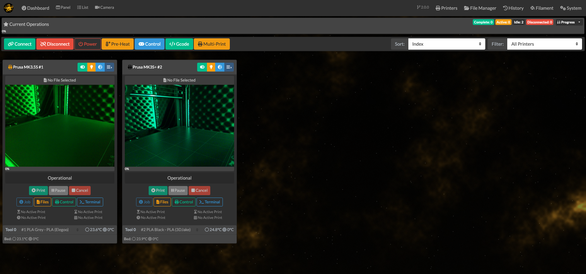
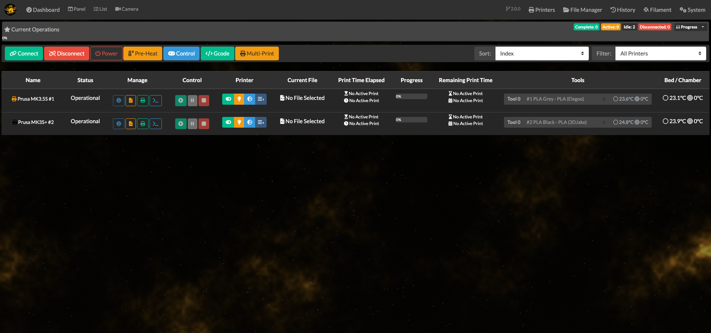
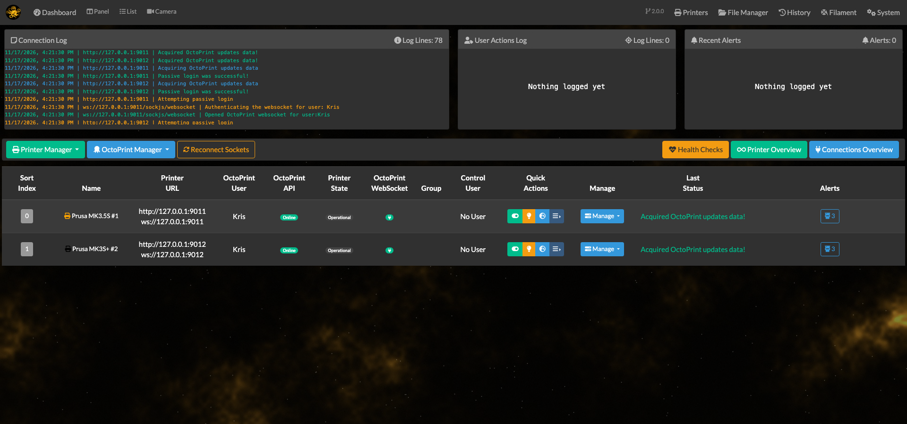
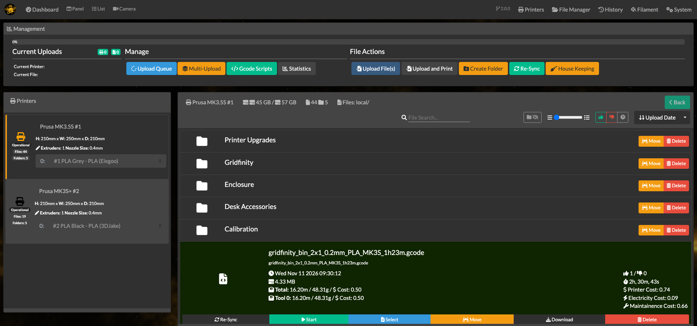
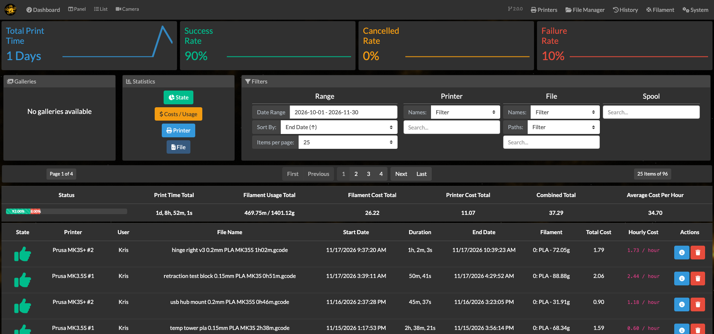
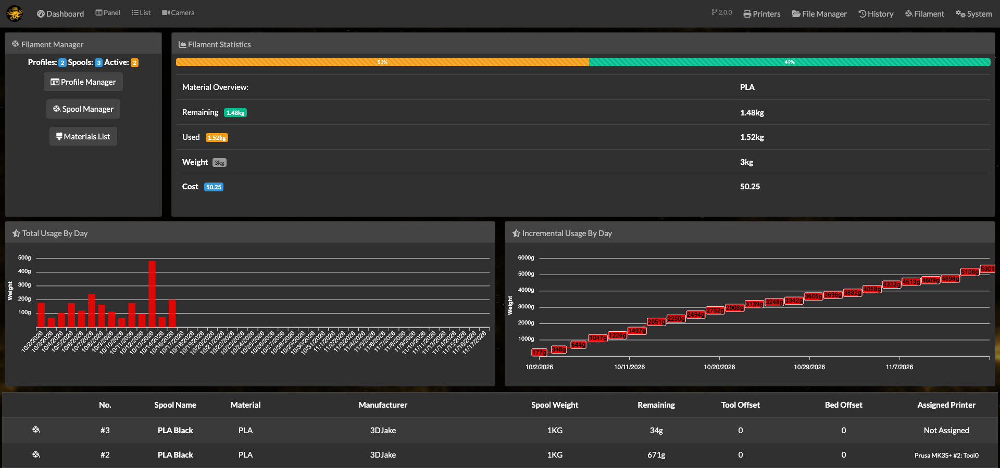
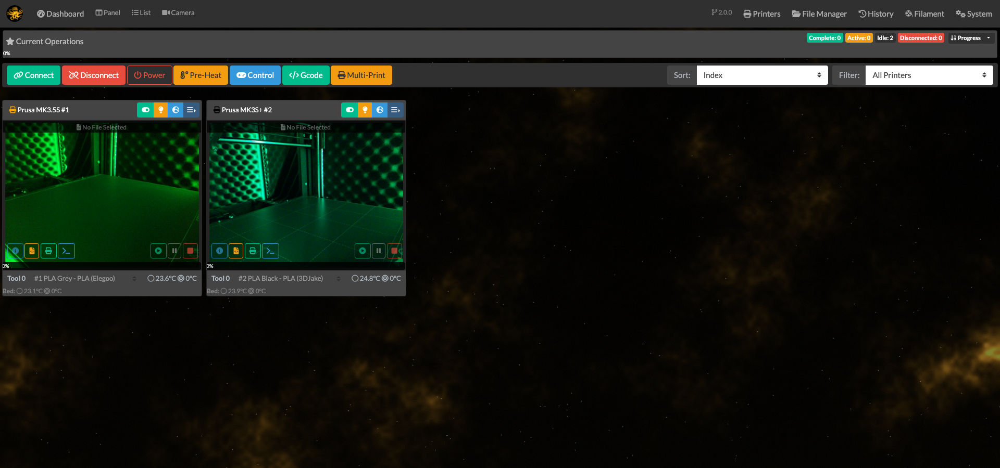

# OctoFarm-Redux

<div align="center">
  

  <p align="center">
    OctoFarm-Redux is a maintained fork of <a href="https://github.com/OctoFarm/OctoFarm">OctoFarm</a>, created by <a href="https://github.com/NotExpectedYet">James Mackay (NotExpectedYet)</a> and its contributors - a single pane of glass that combines multiple OctoPrint instances into one interface, monitoring and managing a 3D printer farm over the OctoPrint API and websocket systems.
  </p>

  <p align="center">
    <strong>Everything here rests on their work.</strong> The application, its architecture, and very nearly all of the
    code are theirs; they built it, and they gave it away for free under the AGPL. This fork maintains what they
    made. Upstream OctoFarm is no longer being updated, so this repository keeps bugfixes and small improvements
    landing on top of it. It is not a successor or a community fork - just their work, kept running and improved, and shared in case it is
    useful to anyone else.
  </p>
</div>

- [About](#about)
- [What's different from upstream](#whats-different-from-upstream)
- [Screenshots](#screenshots)
- [Getting Started](#getting-started)
- [Installation](#installation)
- [Development setup](#development-setup)
- [Deployment](#deployment)
- [License](#license)
- [Acknowledgements](#acknowledgements)
- [Support](#support)

## About

![OctoFarm Dashboard][DashboardScreenshot]

Everything described in this section is OctoFarm's own, built upstream by James Mackay and the project's
contributors. It is what you get from OctoFarm itself; the fork's own changes are in the
[next section](#whats-different-from-upstream).

OctoFarm was built to solve a problem anyone running multiple 3D printers on OctoPrint runs into: how do you manage
several printers from one place? Add your OctoPrint instances and it scans and keeps you up to date on the status of
your whole farm.

- Manage your OctoPrint instances, right down to triggering updates and plugin installs.
- Keep track of all the live data on your farm with a selection of views.
- Manage your OctoPrint file system: turn on housekeeping mode to check off files and bulk-delete them, filter the
  list down to just successful, failed, or never-printed files, and let an age-based sweep auto-select old files for
  you (with per-folder exclusions).
- Get an overview of your farm with the customisable dashboard.
- Manage and track filament/spool usage and cost on your farm.
- Track history and logs for all of your instances.
- Supports a wide variety of OctoPrint plugins to augment the system with more information.

## What's different from upstream

Everything in this section is a change *on top of* OctoFarm, not a replacement for it - the list is long only
because upstream development stopped, not because there was anything wrong with what was built. Some of these are
fixes that never landed upstream, some don't apply to a personal single-maintainer setup, and most of the rest is
bringing dependencies that have since gone end-of-life back up to date.

### New features

**File manager overhaul** - built entirely in this fork:
- Housekeeping mode: tick off files (or "select all visible") and delete them in one go, instead of one at a
  time.
- Filter the list down to successful, failed, or never-printed files.
- Age-based sweep ticks everything older than X days for you to review before deleting, with per-folder
  exclusions.
- Thumbnail hover preview, a density slider to fit more files on screen, search that matches words in any order,
  and a "Hide Folders" toggle.
- Copy a file straight to another printer - pick one or more targets and see which worked.
- The list refreshes itself after anything is added, removed or bulk-changed.
- The temperatures a file was sliced with, shown beside its size: nozzle and bed, first layer and the rest.
  OctoPrint does not track these at all, so they are read out of the gcode itself. PrusaSlicer and OrcaSlicer
  files both work, anything a file does not carry shows as a dash, and a file from a slicer that writes no
  settings block (such as Cura) shows nothing.

**Torch** - turn a printer's light on and off from the command panel. A real toggle that reflects the light's
actual state, and it tells you when the light cannot come on because the printer's PSU is off, instead of
claiming success.

**Maintenance Mode** - stops PSU Control powering a printer off while you are working on it, so the power does
not cut out mid-calibration just because the printer counts as idle. A farm-wide banner names every printer
currently left that way, so one does not sit powered up overnight because somebody forgot. Needs our companion
OctoPrint plugin, [Maintenance Mode (PSU Control)](https://github.com/KrisMakes/OctoPrint-MaintenanceMode), on
each printer you want it for, so it stays off until switched on under System > Server > Features.

**Spool manager** - reworked so the numbers on screen can be trusted:
- Every spool carries a short number you can write on a sticker and put on the physical roll. Leave it blank and
  it takes the next free one, and a deleted spool's number is never handed out again in case its sticker is
  still about.
- That number shows up everywhere the spool does - the spool manager, the overview table and every spool picker
  ("#1 3DJake ecoPLA Black (901g) - PLA") - and both search and sort work on it.
- "Used (g)" now shows what has been used. It used to show what was left, and simply opening a spool to edit it
  could mark the spool empty.
- Remaining has a read-only column of its own, and sorting by Remaining really sorts by remaining.
- A pre-flight check before printing: what the file needs against what is left on the assigned spool, so you
  hear about it before the print starts rather than when it runs dry. The file list flags a file the spool
  cannot finish, and Multi-Print asks once for the whole batch. It only ever warns and always offers "print
  anyway" - both numbers are estimates - and it can be switched off under System > Server > Filament.
- Filament accounting corrected throughout: cost on cancelled prints, totals on a second tool, and spool
  assignments surviving a history edit.

**Camera streaming** - camera feeds come through OctoFarm itself rather than every browser tab connecting to
every printer directly. This is also what stopped Safari loading them at all.

**One connection per browser, not one per camera per tab** - the single largest change in this fork, and the
answer to grey camera panes and buttons that stop responding with nothing on screen to explain why.

A browser only allows about six connections to one address, shared across every tab, and anything that streams
holds one of them open for as long as it is on screen. Two cameras in two tabs, plus the event and monitoring
streams, and the budget is gone - and nothing fails cleanly when it does. The page simply renders with no
printers on it and every button stops working, with no error anywhere saying why.

So the number of connections stopped following the number of viewers. The server opens one connection per
camera however many people are watching, cameras nobody is looking at are not fetched at all, and everything -
cameras, events and monitoring alike - now arrives down a single shared connection per browser instead of one
per tab. A second tab showing the same camera costs nothing, and each printer's Pi serves one stream rather than
one per pane. The old direct endpoints are untouched and still work as a fallback.

One per browser rather than one per tab is the part that matters in Safari, which counts a WebSocket against the
same six-connection budget where Chrome does not. A socket per tab would have gone on eating the very budget
this was meant to free - which is why there is one for the whole browser, shared between every tab you have
open.

The camera half is opt-in, under System > Server > Cameras > Multiplexer, because it changes how every camera on
the farm is delivered and an upgrade should not switch that on for you. Turning it off takes effect immediately
on every open tab rather than at the next reload.

**Raise the head after cancelling** - a cancelled print used to leave the nozzle parked over the plate, in the
way of whatever has to come off it. Cancelling now lifts it ten centimetres clear of wherever the print stopped,
clipped at the top of the Z axis. It waits for the printer to actually stop first, and says so if it gives up
waiting rather than leaving the impression the head moved. It covers every way a print is cancelled - the panel
card, the control modal and bulk actions alike.

**Cancel a single object mid-print** - when one part of a multi-object plate lifts or turns into spaghetti,
cancel just that one and let the rest of the plate finish.

It leads with a plate map: a top-down plan of the bed, drawn automatically from the running job, with every
object in its real position and at its real footprint, numbered and clickable to cancel straight from the
drawing. The one printing right now is highlighted and cancelled ones are dimmed, so a single look lines up
what is on screen with what is in front of you - no counting down a list of filenames and hoping. Nothing has to
be configured, measured or drawn by hand: the plate fills itself in over the first layer as each object starts.

The list underneath names each object by where it sits relative to the others ("back left") rather than by
whatever the slicer called it, because "Part4.STL (Instance 2)" identifies nothing you can see while looking at
a failed print. Cancelling asks first and says plainly what it does and does not do: the rest carries on, but
what is already printed stays on the bed and the nozzle still travels over it.

It works through the Cancel Object OctoPrint plugin, so it does not depend on your printer's firmware supporting
object cancellation. The section is always there and tells you why it is empty - file sliced without object
labels, or the plugin not installed on that printer - rather than quietly disappearing.

**Everything else:**
- Error messages that say what is actually wrong when OctoPrint contradicts itself (for example "already
  printing" while the printer shows disconnected), instead of a generic conflict message.
- Health check failures name the check that failed - printer settings, API, websocket, connection defaults,
  webcam or history - instead of one generic "Failed health check!".
- A page under System showing what is really connected: how many live connections are open, what each has sent
  and dropped, and what the camera hub is doing. It is deliberately not administrator-only, because this is what
  you want to look at when a tab will not load, and a browser in that state cannot sign you in to ask.
- Replaced the toilet-roll filament icon with a real spool.

### Improvements

- Switching back to an open tab no longer throws the whole page away and rebuilds it, which is why moving
  between tabs used to feel slow. The rebuild was there for a good reason - a connection the browser had quietly
  abandoned in the background could not be told apart from a working one, so discarding the lot was the only
  reliable cure. Now that everything runs over one connection, the page can just ask whether it is still alive
  and rebuild only if nothing answers. The full reload still happens where it is still needed, and still holds
  back while a dialog is open or something is half-typed.
- A tab left open across a deploy reloads itself once, instead of running yesterday's build until somebody
  thinks to refresh it. Three tabs left open across a day of deploys were still holding a camera connection
  each - a whole browser's worth between them - a week after that limit had been lifted.
- Camera frames are painted in step with the display rather than the instant they arrive. A camera sends thirty
  frames a second and a screen redraws sixty times a second, so drawing each frame the moment it lands made the
  spacing uneven. Chrome hid it; Safari showed it as judder.
- How far behind a browser has fallen is now measured by the browser itself. Nothing on the server could see it,
  so a viewer could sit a full second behind on every camera, permanently, while the server was satisfied
  everything was fine. A viewer that falls behind now has frames dropped rather than piled up.
- A page that loses its cameras writes down why - what the connection did, what each camera was told, and how
  long since each pane last drew a frame - and the next page to load sends it on. The reload that ends the
  problem is therefore how the evidence arrives rather than the end of it, and a page that recovers on its own
  reports itself just as readily.
- Printer cards on the panel, camera and group views are sized by width rather than by a fixed column count, so
  the number of columns follows the window and the printer count. Six per row is comfortable on a large monitor
  and unreadable on a laptop, so the setting is now a card size - compact, default or large - that means the
  same thing on any screen. Replaces the separate Camera and Group column settings.
- Leaving the page hands every camera connection back, so a tab sitting behind another window no longer holds
  one per camera, and the pane keeps showing its last frame rather than going blank while it is away.
- A camera that dies while you are watching is recovered on its own, and one showing an unchanging picture (a
  dark enclosure overnight) is not mistaken for a dead one and reconnected all night.
- Camera panes no longer leak a connection every time a printer card is redrawn. In Safari a discarded camera
  element keeps its stream open, so they piled up until the browser ran out of connections and every camera went
  blank - at which point reconnecting could not help either, because the reconnect could not get a connection
  of its own.
- A printer's camera only streams into its modal while that modal is actually open. Each printer used to hold a
  second live stream for a modal nobody had opened, which on a two-printer farm was four of the six connections
  a browser allows.
- The camera aspect-ratio setting is applied to the camera views, instead of being saved and then ignored.
- Print-finish time now displays in full (it was silently truncated) and is actually correct (it was off by
  hours, from a container timezone bug).
- Panel and camera cards stay a consistent height regardless of printer state.
- Static assets cache correctly in the browser, so a deployed fix is guaranteed to reach you rather than
  possibly serving stale code.
- Entire stack updated to current, supported versions - Node, MongoDB, Express, Mongoose and all major
  dependencies, several of which were end-of-life.

### Bug fixes

- Alerts never actually worked - a data bug meant a configured alert never matched any printer, so nothing ever
  fired regardless of configuration.
- Opening a spool in the Spool Manager and saving it, without changing anything, silently marked the spool as
  fully used: the "Used" column was showing what was left, and the editor wrote that back into used.
- Saving any filament setting, while "allow single spools on multiple printers" happened to be off, detached
  every spool from every printer - even though spools can still be assigned one at a time when it is off.
- Every error message in the app rendered grey instead of red, so failures looked like ordinary notices.
- A lingering websocket handshake from a printer being reconnected could crash the entire server, taking
  monitoring for the whole farm down with it.
- A camera that failed to reconnect when returning to a tab never tried again, and a partially delivered frame
  left the picture half grey with nothing to recover it.
- The camera proxy dropped healthy cameras 30 seconds after a tab was backgrounded, mistaking the browser having
  stopped reading for the printer having gone quiet.
- The camera view spread its cards across the row with empty gaps between them - on a two-printer farm, one
  card at each end. A stray empty element after each card was being counted as a column of its own.
- A camera that was simply switched off was retried every fifteen seconds forever, because shutting a stream
  down looked to the browser like the camera coming back.
- Quick Connect's state could stop syncing entirely if one button was missing from the page.
- Spool cost was being silently under-reported on cancelled/failed prints (double-applied completion-ratio bug).
- Thumbnails could silently fail to save for any printer with API access control enabled.
- Gcode thumbnails never actually displayed. The browser was asking each printer for them directly, and
  OctoPrint serves thumbnails behind its access control, so it refused every time. They now go through the same
  proxy as every other OctoPrint call. Fixed in the job modal, the file manager and both camera fallbacks.
- The job modal rendered a broken image for any file that had no thumbnail at all.
- The job modal showed "NaN / NaN" for electricity, maintenance and printer-total costs whenever the matching
  options were switched off in server settings. It now says the cost was not calculated.
- The spool Remaining column printed "36.811371464054105g". It now shows whole grams, while the stored value
  keeps its precision so repeated small deductions still add up correctly.
- Camera streams rendered as empty boxes in Safari inside the card grid.
- Printer setup could hang forever on "Setting Up" and never appear in the dashboard.
- Old temperature history was never actually cleaned up - over 2 million stale records had piled up.
- File-action errors (delete, move, select) showed the same vague message for every possible cause.
- A crashed background task used to bring down the entire app; it's now logged and the app keeps running.
- Login sessions no longer reset on every restart. The session store moved into MongoDB, and the container now
  keeps its signing key in the data volume instead of minting a new one each start - either one on its own
  would still have logged everybody out.
- Container shutdowns are now clean instead of abrupt (previously risked database corruption).
- A finished print could keep showing "Complete" and stale progress after the file was unselected.
- The file manager's upload queue could silently upload the wrong file and drop one from the queue when more than
  one upload was queued at once.
- Deleting or exporting several history/log databases from System Settings threw an error and didn't work at all.
- Wiping a database from System Settings could double-restart the server and double-send its response.
- Editing a filament history entry could silently wipe spool assignments from other tools on the same job.
- A task with no repeat interval rendered the literal word "undefined" in System > Tasks.
- "Files common to all printers" was wrong whenever a printer's file list hadn't finished caching yet.
- A missing/renamed asset served a misleading 200 OK web page instead of a real 404.
- Live-updating data (websocket URL) could be missing from the printer summary, breaking monitoring views for
  affected printers.
- A CSP misconfiguration could block the bundled theme's Google web font from loading.
- Server-sent events (live dashboard/monitoring updates) could get stuck buffering for seconds under compression.
- Filament cost totals could be wrong on prints that only used a non-zero tool number.
- Alert/webhook scripts could receive a permanent placeholder instead of the real history/error record ID.
- Spool weight bookkeeping and snapshot capture had inverted or incomplete guard conditions.
- A database write failure could silently look like it succeeded to the code that requested it.
- Task presets used by more than one scheduled task could cross-contaminate each other's settings.

### Security

- Closed a bypass where the registration page could be POSTed to directly and create an account even while
  registration was disabled in settings.
- The entire server-side template source tree used to be served as static files to anyone, logged in or not.
- Login and registration now have their own strict rate limit; previously the only limit in place was far too
  generous to stop password guessing.
- Removed a long-deprecated HTTP library and a stale dependency with a known sandbox-escape vulnerability.
- The live event stream no longer responds to unauthenticated requests.
- Your session cookie is no longer forwarded to third-party printers through the camera/file proxy.
- Every advisory `npm audit` reports against the server is resolved: thirteen down to none, ten of which were in
  the production tree. Where an upgrade existed it was taken; where a library pinned a vulnerable transitive
  dependency and upstream had gone quiet, that dependency is pinned to a patched version through an `overrides`
  entry; and `node-upnp-ssdp`, unmaintained since 2015, was dropped for a small built-in SSDP client that does
  only what printer auto-discovery actually needs.
- The client's bundled libraries went from thirty advisories to one. The remaining one is bootbox, and it has no
  fix: it renders dialog messages and titles as HTML by design, and upstream closed the report as out of scope,
  so there is no patched release to move to. Instead, every untrusted value that reaches a dialog - gcode file and
  folder paths, printer names, spool labels, strings relayed from an OctoPrint instance - is escaped at the call
  site, behind one shared helper that documents why.

### Developer / build

- Reproducible builds, content-hashed asset filenames, and an asset-manifest system (no more hardcoded bundle
  names).
- New smoke tests requiring no framework, database, or hardware: proxy behavior, cross-printer file transfer, and
  build/manifest verification.
- Working lint config (previously silently never ran) and a cleaned-up, drift-free dependency lockfile.
- Removed dead code (an old camera-snapshot path fully superseded by the streaming proxy), nine unused server
  dependencies, and a Dockerfile that could no longer build this deployment.
- Stopped shipping webpack source maps in the built image.
- Various icon/favicon fixes for correct rendering in Safari.

## Screenshots

<table>
<tr>
<td width="50%"><a href="screenshots/panelView.png"></a><br><b>Panel view</b> - every printer as a card, with its camera, temperatures and progress at a glance.</td>
<td width="50%"><a href="screenshots/listView.png"></a><br><b>List view</b> - the same farm as a dense table when you have more printers than screen.</td>
</tr>
<tr>
<td width="50%"><a href="screenshots/printerManager.png"></a><br><b>Printer manager</b> - add, edit and troubleshoot instances, including OctoPrint updates and plugin installs.</td>
<td width="50%"><a href="screenshots/fileManager.png"></a><br><b>File manager</b> - browse and upload gcode across the whole farm, with sliced settings read from the files themselves.</td>
</tr>
<tr>
<td width="50%"><a href="screenshots/history.png"></a><br><b>History</b> - every finished print with its cost, filament use and outcome.</td>
<td width="50%"><a href="screenshots/filament.png"></a><br><b>Filament manager</b> - spools, what is loaded where, and what each print consumed.</td>
</tr>
<tr>
<td colspan="2"><a href="screenshots/cameraView.png"></a><br><b>Camera view</b> - every camera on the farm on one screen, served through a single shared stream per printer.</td>
</tr>
</table>

## Getting Started

This fork doesn't change how the application works day-to-day, only fixes and small additions on top. Upstream's
documentation site (`docs.octofarm.net`) is offline and its domain has lapsed, so what remains of the original
documentation lives in [the original repository](https://github.com/OctoFarm/OctoFarm). Everything specific to this
fork is in this README.

## Installation

### Unraid

The Unraid template is in this repository at [`templates/octofarm-redux.xml`](templates/octofarm-redux.xml) and is
submitted to Community Applications, so the normal route is to search for **OctoFarm-Redux** in the **Apps** tab and
install it from there. The image bundles MongoDB, so there is no second container to add.

Two fields matter on first install:

- **Session key** (`SUPER_SECRET_KEY`) - safe to leave empty. The container generates one on first start and keeps
  it in the data volume, so logins survive a restart or a recreation. Set it explicitly only if you would rather
  manage the key yourself, or need the same key across two installs.
- **Database config** (`/data/configdb`) - leave the mapping in place. The `mongo` base image declares that path
  as a volume, so removing it strands an anonymous volume on every redeploy.

Open the web interface afterwards and register the first account; it becomes the administrator.

Coming from an existing OctoFarm install, point **Thumbnails** and **Scripts** at the old `images` and `scripts`
folders and they carry over unchanged. The database does not: this image runs its own `mongod` against `/data/db`,
so the old MongoDB container's contents have to be moved across with `mongodump` and `mongorestore`.

### Docker

Released images are published to GitHub Container Registry as `linux/amd64`:

```sh
docker run -d --name octofarm-redux --restart unless-stopped \
  -p 4000:4000 \
  -e SUPER_SECRET_KEY='a long random string' \
  -e TZ=Europe/London \
  -v /path/to/appdata/db:/data/db \
  -v /path/to/appdata/configdb:/data/configdb \
  -v /path/to/appdata/images:/app/images \
  -v /path/to/appdata/logs:/app/logs \
  -v /path/to/appdata/scripts:/scripts \
  ghcr.io/krismakes/octofarm-redux:latest
```

Remove the container with `docker rm -v` so its anonymous volumes go with it.

## Development setup

### Requirements
- Git
- Node.js >= 20.19.0 (the Docker image and CI both use Node 24)
- npm

1. Clone the repo

```sh
git clone https://github.com/KrisMakes/OctoFarm-Redux.git
```

2. Install the mono-repo eslint dependencies (eslint, prettier and nodemon)

```sh
npm install
```

3. Install server and client dependencies

```sh
npm run setup-dev
```

4. Create an `.env` file in the project root, e.g. `OctoFarm-Redux/.env`. Every
   setting is documented in [`.env.example`](.env.example), and every one has a
   default, so copying it unedited is enough to start:

```sh
cp .env.example .env
```

   The minimum, if you would rather write it yourself:

```dotenv
NODE_ENV=development
MONGO=mongodb://127.0.0.1:27017/octofarm
OCTOFARM_PORT=4000
```

5. Build the latest client
```sh
npm run build
```

6. (Optional) Watch for client changes, requires a secondary console.
```sh
npm run dev-client
```

7. Start the server

```sh
npm run dev-server
```
- The developer version uses nodemon for live server reloading on changes, and outputs all logs to the console.

## Deployment

Released images are built from `monolithic.Dockerfile` by
[`.github/workflows/docker-publish.yml`](.github/workflows/docker-publish.yml), which runs on a `v*` tag, pushes
`ghcr.io/krismakes/octofarm-redux`, and fails the release if the image it just pushed does not come up healthy. The
same image builds locally, and bundles MongoDB, so there is nothing else to deploy alongside it:

```sh
docker build -f monolithic.Dockerfile -t octofarm-redux:local .
```

Two things to get right when redeploying, both easy to miss:

- The base image is `mongo:8.0`, which declares **both** `/data/db` and `/data/configdb` as volumes. Map only
  `/data/db` and Docker invents an anonymous volume for `/data/configdb`; remove the old container without `-v`
  and that volume is stranded, every single deploy. Map both paths, and remove with `docker rm -v`.
- `SUPER_SECRET_KEY` is kept in `/data/db/.super_secret_key` when it is not passed in, so it survives a redeploy
  on its own - it sits inside the database mapping rather than beside it, because that is the one mapping the
  container cannot run without. Wiping the database wipes the key with it, and an explicit variable always wins.

Client-side changes need a client rebuild (`cd client && npm run build`) before committing - the prebuilt webpack
output is committed under `server/assets/`, and a client-only edit without a rebuild ships stale JS.

## License

This work [is licensed](LICENSE) under the [GNU Affero General Public License v3](https://www.gnu.org/licenses/agpl-3.0.html).

THE SOFTWARE IS PROVIDED "AS IS", WITHOUT WARRANTY OF ANY KIND, EXPRESS OR IMPLIED, INCLUDING BUT NOT LIMITED TO THE WARRANTIES OF MERCHANTABILITY, FITNESS FOR A PARTICULAR PURPOSE AND NONINFRINGEMENT.

## Acknowledgements

**This project would not exist without the people below. None of the work in this fork is original in any meaningful
sense - it is maintenance on something other people designed, wrote, and released for free.**

- **[James Mackay (NotExpectedYet)](https://github.com/NotExpectedYet)** - the creator and original maintainer of
  [OctoFarm](https://github.com/OctoFarm/OctoFarm). He wrote the application this fork is built from: the printer
  management, the monitoring views, the file and filament managers, the history system, the OctoPrint API and
  websocket layer - the whole of it. Years of his work were given away under a free licence, which is the only
  reason a fork like this is possible at all. Every feature listed above sits on that foundation.
- **The [OctoFarm](https://github.com/OctoFarm/OctoFarm) contributors** - everyone who filed issues, wrote code,
  tested releases, translated the interface, and helped people in the community. Their work is in here too.
- **[Gina Häußge](https://octoprint.org/) and the OctoPrint project** - OctoFarm manages OctoPrint instances, so
  without OctoPrint neither upstream nor this fork would exist.

If you found your way here looking for OctoFarm itself, go to
**[the original project](https://github.com/OctoFarm/OctoFarm)** first. This fork makes no claim to be its
continuation. Note that upstream's website and documentation domains have lapsed - `octofarm.net` and
`docs.octofarm.net` no longer resolve to the project - so the repository itself is all that is left of it.

Like upstream, this fork stays under the same [AGPL-3.0 licence](LICENSE) it was given under.

## Support

OctoFarm-Redux is free. If the work in this fork - the fixes and additions listed above - has been useful to you,
you can leave a tip at [ko-fi.com/krismakes](https://ko-fi.com/krismakes). Entirely optional; nothing is locked behind
it.

[DashboardScreenshot]: screenshots/dashboard.png
